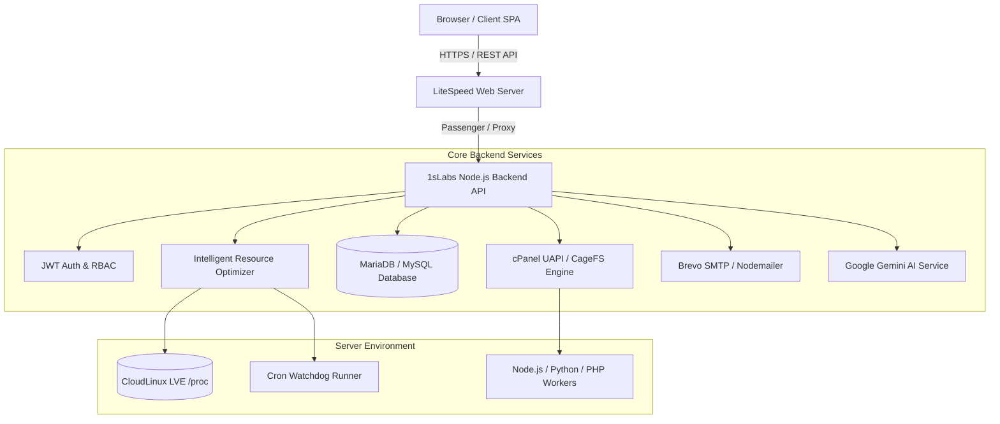

<div align="center">
  <a href="https://1slabs.my.id">
    
  </a>
  <br/><br/>
  
  <p align="center">
    <strong>Enterprise IT Services & Managed Cloud Hosting Platform</strong><br/>
    Platform penyedia managed hosting performa tinggi, runtime management (Node.js, Python, Laravel), serta sistem automasi monitoring resource adaptif CloudLinux LVE.
  </p>

  <p align="center">
    <a href="https://1slabs.my.id"></a>
    <a href="https://github.com/dzikriii24/1s_Labs"></a>
    <a href="https://1slabs.my.id/docs"></a>
  </p>

  <p align="center">
    
    
    
    
    
    
    
    
    
  </p>
</div>

---

## 📌 Daftar Isi

1. [Tentang 1sLabs](#-tentang-1slabs)
2. [Fitur Unggulan Sistem](#-fitur-unggulan-sistem)
3. [Arsitektur & Tech Stack](#-arsitektur--tech-stack)
4. [Intelligent Resource Management (CloudLinux LVE)](#-intelligent-resource-management-cloudlinux-lve)
5. [Struktur Direktori Proyek](#-struktur-direktori-proyek)
6. [Panduan Instalasi & Menjalankan Lokal](#-panduan-instalasi--menjalankan-lokal)
7. [Environment Variables (.env)](#-environment-variables-env)
8. [Deployment & Server Tuning](#-deployment--server-tuning)
9. [Dokumentasi API Terintegrasi](#-dokumentasi-api-terintegrasi)
10. [Lisensi & Kontak](#-lisensi--kontak)

---

## 🚀 Tentang 1sLabs

**1sLabs** adalah platform terpadu yang memadukan layanan profesional software development, web application engineering, dan managed cloud hosting performa tinggi. 

Dibangun dengan arsitektur modern berbasis **React 18 + Vite** di sisi klien dan **Node.js Express + cPanel UAPI** di sisi backend, 1sLabs dirancang untuk menangani operasional hosting multi-tenant, penyediaan domain otomatis, manajemen runtime aplikasi independen (Node.js, Python WSGI, dan Laravel PHP), serta mitigasi resource server secara otonom.

---

## ✨ Fitur Unggulan Sistem

### 1. 🛡️ Intelligent CloudLinux LVE Resource Optimizer
- **Pemantauan Metrik LVE Real-Time:** Memantau CPU (%), Physical Memory (RAM), Entry Processes (EP), Number of Processes (NPROC), I/O Speed, IOPS, dan Inodes secara langsung via cPanel UAPI.
- **5-Level Adaptive Thresholds:** Normal (Optimal), Warning, High Usage, Critical, dan Emergency dengan mekanisme anti-flapping (Hysteresis cooldown 180s).
- **Graceful Process Pruning:** Perlindungan whitelist mutlak untuk layanan penting (LiteSpeed runner, SSH, master backend, MySQL handler) dan penghentian proses idle secara aman via sinyal `SIGTERM` (Zero mass `kill -9`).
- **Pembersihan Otomatis:** Rotasi log raksasa (`stderr.log`), pembersihan cache/temp files kedaluwarsa (> 24 jam), dan recycle worker duplikat yang idle.

### 2. ⚡ Multi-Runtime Application Selector
- **Node.js Selector:** Manajemen versi Node (v20, v22, v24), startup file, environment variables, restart instance, serta penyesuaian memory space.
- **Python WSGI Selector:** Manajemen aplikasi Python (v3.11 WSGI / Passenger), virtual environment isolated, requirements installer, dan file manager terintegrasi.
- **Laravel PHP Selector:** Dukungan Laravel deployment, eksekusi artisan commands (`key:generate`, `migrate`, `cache:clear`), dan visual file explorer.

### 3. 🌐 Domain, DNS & SSL Automation
- Integrasi otomatis dengan cPanel UAPI untuk provisioning Subdomain dan Addon Domain.
- Pengecekan status DNS pointing (A record & CNAME) secara real-time.
- Triggering AutoSSL cPanel dan penanganan sertifikat SSL Let's Encrypt / Sectigo.

### 4. 📊 Portal Pelanggan & Admin Dashboard
- **Admin Dashboard:** Manajemen pengguna, pesanan hosting, verifikasi pembayaran bukti transfer, analitik website, meeting schedule, dan marketing lead management.
- **Customer Portal:** Manajemen layanan aktif, klaim Free Plan CSR developer, pengelolaan database MySQL (phpMyAdmin SSO & remote access), dan FTP account provisioning.

### 5. 📬 Marketing & Communication Hub
- **AI-Powered Outreach:** Integrasi Google Gemini AI untuk personalisasi subjek dan isi email promosi bisnis.
- **Brevo SMTP Relay:** Pengiriman email transaksional dan marketing berkecepatan tinggi dengan autentikasi DKIM & SPF terverifikasi.

---

## 🛠️ Arsitektur & Tech Stack



| Layer | Komponen / Teknologi |
|---|---|
| **Frontend Framework** | React 18, TypeScript, Vite 5 |
| **Styling & UI Components** | TailwindCSS, Lucide React, Framer Motion, SweetAlert2 |
| **State & Navigation** | React Router DOM v7, React Helmet Async |
| **Backend Framework** | Node.js (v22), Express.js |
| **Database** | MariaDB 10.11 / MySQL (mysql2 connection pool) |
| **Hosting Environment** | CloudLinux 9.8 (el9_8 x86_64), LiteSpeed Web Server, CageFS |
| **Application Server** | Phusion Passenger & LiteSpeed `lsnode` runner |
| **Email Relay** | Brevo SMTP Relay (Port 2525) |
| **AI Integration** | Google Gemini API (gemini-3.8-flash) |

---

## ⚙️ Intelligent Resource Management (CloudLinux LVE)

Sistem mengimplementasikan mesin mitigasi beban hosting untuk menjaga alokasi CloudLinux tetap stabil di bawah batas kuota:

```
┌────────────────────────────────────────────────────────────────────────┐
│                      ADAPTIVE RESOURCE THRESHOLD                       │
├──────────────┬───────────────┬─────────────────────────────────────────┤
│ Level        │ Ambang Beban  │ Tindakan & Protokol Proteksi            │
├──────────────┼───────────────┼─────────────────────────────────────────┤
│ Level 1      │ 0% – 69%      │ Optimal: Housekeeping rutin, clean tmp. │
│ Level 2      │ 70% – 79%     │ Warning: Deteksi proses terberat, rotasi│
│ Level 3      │ 80% – 89%     │ High Usage: Recycle idle duplicate work │
│ Level 4      │ 90% – 94%     │ Critical: Freeze queue, graceful prune. │
│ Level 5      │ 95% – 100%    │ Emergency: Lockdown mode, email alert.  │
└──────────────┴───────────────┴─────────────────────────────────────────┘
```

### Kebijakan Perlindungan Khusus:
1. **Zero Mass Kill:** Dilarang keras menggunakan `kill -9` massal atau mematikan web server aktif. Seluruh penghentian wajib melalui drain `SIGTERM` (15).
2. **Whitelist Layanan Inti:** LiteSpeed master runner, sesi SSH administrator, koneksi database, dan active request worker dilindungi dari pemutusan otomatis.
3. **Hysteresis Anti-Flapping:** Penurunan status dari level darurat ke normal memerlukan penurunan penggunaan di bawah batas recovery dan masa jeda stabil (cooldown) minimal 180 detik.

---

## 📂 Struktur Direktori Proyek

```plaintext
1sLabs-website/
├── backend/                        # Backend Server (Node.js Express)
│   ├── index.js                    # Entrypoint aplikasi Express
│   ├── scripts/                    # Skrip database & otomasi server
│   │   ├── migrate_resource_optimization.js
│   │   ├── run_resource_optimizer.js
│   │   └── reset_nproc.sh
│   ├── src/
│   │   ├── db.js                   # MySQL pool connection manager
│   │   ├── middleware/             # Auth, role check, & file upload
│   │   ├── routes/                 # REST API routes (Admin, Portal, Apps, LVE)
│   │   │   ├── admin.routes.js
│   │   │   ├── nodejs.routes.js
│   │   │   ├── python.routes.js
│   │   │   └── laravel.routes.js
│   │   ├── services/               # Integrasi cPanel, Email, AI, & Optimizer
│   │   │   ├── cpanel.service.js
│   │   │   ├── resourceOptimizer.service.js
│   │   │   └── email.service.js
│   │   └── utils/                  # Activity logger, helpers, file sandbox
│   └── package.json
│
├── public/                         # Public static assets & metadata
│   ├── logo-1slabs.png             # Logo resmi 1sLabs
│   ├── logo-mark.png               # Icon badge 1sLabs
│   ├── llms.txt                    # Konteks AI & ikhtisar platform
│   ├── sitemap.xml                 # SEO sitemap
│   └── robots.txt
│
├── src/                            # Frontend Source (React 18 TypeScript)
│   ├── components/
│   │   ├── admin/                  # Dashboard administrator & views
│   │   │   └── views/
│   │   │       ├── ServerMonitoringView.tsx  # Dashboard visual LVE
│   │   │       ├── ResourceUsageView.tsx     # Live process inspector
│   │   │       └── NodeJsApplicationsAdminView.tsx
│   │   ├── portal/                 # Portal pelanggan & runtime managers
│   │   │   ├── NodeJsAppsTab.tsx
│   │   │   ├── PythonAppsTab.tsx
│   │   │   └── LaravelAppsTab.tsx
│   │   └── layout/                 # Header, Footer, Navigation
│   ├── pages/                      # Halaman rute publik & autentikasi
│   ├── services/
│   │   └── api.ts                  # Client HTTP request & TypeScript types
│   ├── App.tsx                     # Rute utama React
│   └── main.tsx
│
├── .gitignore
├── package.json                    # Frontend dependencies
├── tsconfig.json
├── vite.config.ts                  # Vite build & chunking configuration
└── README.md
```

---

## 💻 Panduan Instalasi & Menjalankan Lokal

### Prasyarat:
- **Node.js:** Versi 20.x atau 22.x LTS
- **Package Manager:** npm atau yarn
- **Database:** MariaDB atau MySQL 8.x

### 1. Clone Repository
```bash
git clone https://github.com/dzikriii24/1s_Labs.git
cd 1s_Labs
```

### 2. Setup Backend API
```bash
cd backend
npm install

# Buat dan sesuaikan konfigurasi .env
cp .env.example .env

# Jalankan server backend (development mode)
npm run dev
```

### 3. Setup Frontend
Buka terminal baru di root direktori proyek:
```bash
# Install dependencies frontend
npm install

# Jalankan frontend development server
npm run dev
```
Aplikasi frontend akan berjalan di `http://localhost:5173` dan backend API di `http://localhost:3000`.

### 4. Build untuk Production
```bash
npm run build
```
Hasil build statis akan dikompilasi ke direktori `dist/` dengan optimasi chunking minified.

---

## 🔐 Environment Variables (.env)

Buat file `.env` di dalam folder `backend/`:

```env
# Database Credentials
DB_HOST=127.0.0.1
DB_PORT=3306
DB_USER=u1zh8984_oneslabs
DB_PASS=your_strong_database_password
DB_NAME=u1zh8984_oneslabs

# Application & Security
PORT=3000
NODE_ENV=production
JWT_SECRET=your_jwt_secret_key_minimum_32_characters
JWT_EXPIRES_IN=7d
BASE_URL=https://1slabs.my.id
CPANEL_URL=https://1slabs.my.id:2083

# Mail Configuration (Brevo SMTP Relay)
MAIL_HOST=smtp-relay.brevo.com
MAIL_PORT=2525
MAIL_SECURE=false
MAIL_USER=your_brevo_smtp_user
MAIL_PASSWORD=your_brevo_smtp_key
MAIL_FROM_ADDRESS=info@1slabs.my.id
MAIL_FROM_NAME=1sLabs
MAIL_ADMIN_RECIPIENT=admin@1slabs.my.id

# Artificial Intelligence (Gemini API)
GEMINI_API=your_google_gemini_api_key
```

> [!CAUTION]
> **Keamanan Kredensial:** Jangan pernah menyimpan file `.env` ke git repository publik. Pastikan `.env` terdaftar di `.gitignore`.

---

## 🚢 Deployment & Server Tuning

### 1. Konfigurasi LiteSpeed & Passenger (.htaccess)
Untuk mencegah lonjakan Entry Processes dan thread bloat pada akun shared CloudLinux, letakkan konfigurasi ini di file `.htaccess` aplikasi backend:

```apache
# CLOUDLINUX PASSENGER CONFIGURATION
PassengerAppRoot "/home/u1zh8984/oneslabs-backend"
PassengerBaseURI "/api"
PassengerNodejs "/home/u1zh8984/nodevenv/oneslabs-backend/22/bin/node"
PassengerAppType node
PassengerStartupFile index.js
PassengerMaxRequests 1000
PassengerPoolIdleTime 180
PassengerMinInstances 1

# LITESPEED ENVIRONMENT VARS TUNING
<IfModule Litespeed>
SetEnv UV_THREADPOOL_SIZE 2
SetEnv NODE_OPTIONS "--max-old-space-size=160"
</IfModule>
```

### 2. Cron Job Watchdog Otomatis
Jadwalkan cron runner di cPanel untuk pemantauan adaptif otonom:
```cron
# Eksekusi optimizer cerdas tiap menit dengan flock lock
* * * * * /bin/bash /home/u1zh8984/reset_nproc.sh >/dev/null 2>&1

# Backup database otomatis setiap pukul 02:00 dini hari
0 2 * * * source /home/u1zh8984/nodevenv/oneslabs-backend/22/bin/activate && node /home/u1zh8984/oneslabs-backend/scripts/run_daily_db_backups.js >> /home/u1zh8984/backups/backup.log 2>&1
```

---

## 📡 Dokumentasi API Terintegrasi

| Method | Endpoint | Hak Akses | Deskripsi |
|---|---|---|---|
| `GET` | `/api/health` | Publik | Status health check server API |
| `POST` | `/api/auth/login` | Publik | Autentikasi user & penerbitan token JWT |
| `GET` | `/api/admin/server/monitoring` | Admin | Metrik LVE aktual, 5-level status, & tren |
| `GET` | `/api/admin/server/processes` | Admin | Daftar live processes dengan klasifikasi cerdas |
| `POST` | `/api/admin/server/kill-process` | Admin | Penghentian aman proses via SIGTERM |
| `POST` | `/api/admin/server/optimization/run` | Admin | Menjalankan adaptif optimasi (Live / Dry-Run) |
| `GET` | `/api/admin/server/database/audit` | Admin | Audit koneksi pool & daftar tabel MySQL terbesar |
| `GET` | `/api/nodejs/apps` | Pelanggan | Daftar aplikasi Node.js milik pengguna |
| `POST` | `/api/nodejs/apps/create` | Pelanggan | Membuat aplikasi Node.js baru di cPanel |
| `GET` | `/api/python/apps` | Pelanggan | Daftar aplikasi Python WSGI milik pengguna |
| `GET` | `/api/laravel/apps` | Pelanggan | Daftar deployment aplikasi Laravel |

---

## 📄 Lisensi & Kontak

Proyek ini dikembangkan dan dikelola secara resmi oleh **Tim Engineer 1sLabs**.

- **Website:** [https://1slabs.my.id](https://1slabs.my.id)
- **Email:** [info@1slabs.my.id](mailto:info@1slabs.my.id)
- **WhatsApp Hotline:** [+62 851-5629-6580](https://wa.me/6285156296580)
- **Lokasi Datacenter:** Tier-3 Datacenter Jakarta, Indonesia (IP: `103.119.237.132`)

<div align="center">
  <sub>Copyright &copy; 2026 1sLabs. All rights reserved.</sub>
</div>
